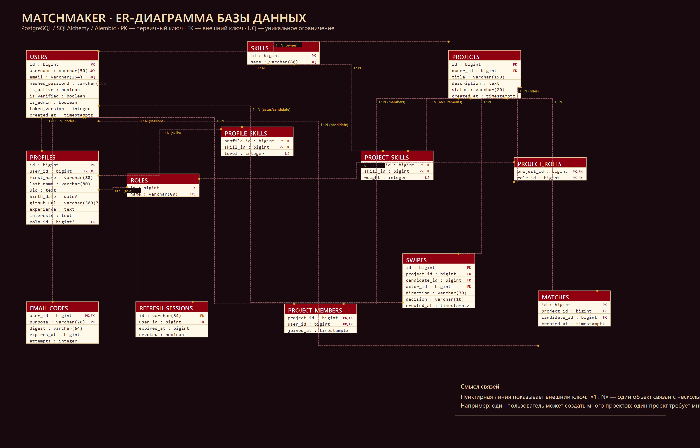
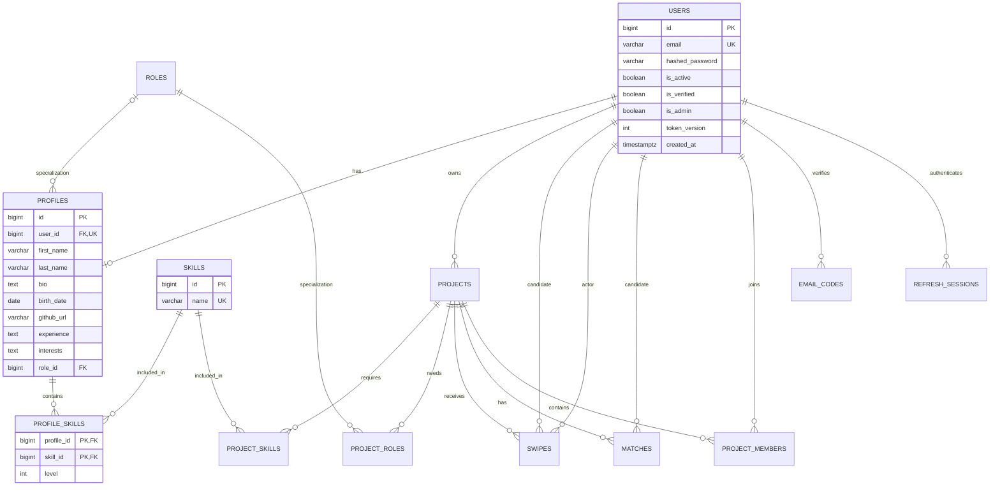

# Схема базы данных Matchmaker

Реализация следует присланной схеме USERS → PROFILES → PROFILE_SKILLS → SKILLS.
В PROFILE_SKILLS используются два поля с составным первичным ключом, а не дополнительные колонки PK_FK.
На PostgreSQL идентификаторы — BIGINT, временные метки — TIMESTAMPTZ. SQLite применяется только как переносимый локальный и тестовый режим.

## ER-диаграмма для отчёта

Готовый PNG-файл для загрузки в Moodle или вставки в документ: [er-diagram.png](er-diagram.png).
Он показывает полную схему текущей реализации, включая авторизацию, профили, навыки, проекты, свайпы и matches.

## Словарь таблиц

| Таблица | Ключ и связи | Назначение и ограничения |
|---|---|---|
| users | id PK; username UNIQUE; email UNIQUE | Публичный username обрезается по краям и хранится как введён пользователем; email приводится к нижнему регистру; пароль хранится как Argon2-хеш; права администратора меняются только оператором |
| profiles | id PK; user_id FK UNIQUE; role_id FK nullable | При регистрации создаётся пустая анкета; дата рождения не отдаётся другим пользователям |
| skills | id PK; name UNIQUE | Справочник технологий |
| roles | id PK; name UNIQUE | Backend, Frontend, iOS и другие специализации; не права доступа |
| profile_skills | PK(profile_id, skill_id) | CHECK level BETWEEN 1 AND 5 |
| projects | id PK; owner_id FK | Статусы open, closed, blocked; владелец берётся из JWT |
| project_skills | PK(project_id, skill_id) | CHECK weight BETWEEN 1 AND 5 |
| project_roles | PK(project_id, role_id) | Требуемые специализации |
| swipes | id PK; project_id, candidate_id, actor_id FK | UNIQUE(project_id, candidate_id, direction); два направления, like/pass |
| matches | id PK; project_id, candidate_id FK | UNIQUE(project_id, candidate_id); фиксируется взаимный интерес |
| project_members | PK(project_id, user_id) | Вступление кандидата после match, joined_at |
| email_codes | PK(user_id, purpose) | HMAC кода, срок действия, количество попыток; код одноразовый |
| refresh_sessions | id PK; user_id FK | Срок действия и флаг отзыва; обновление JWT атомарно отзывает старую сессию |

Для отсутствующих необязательных полей используются NULL; обязательные строки анкеты первоначально пустые. Значения по умолчанию задаёт ORM при INSERT. При ручном SQL нужно указывать все NOT NULL поля без server default.

## Удаление и индексы

Удаление пользователя каскадно удаляет профиль, его навыки, сессии и коды. Владелец существующего проекта защищён RESTRICT. Удаление проекта каскадно удаляет требования, свайпы, совпадения и участников. Навыки и роли, на которые ссылаются требования, защищены RESTRICT; удаление роли анкеты устанавливает NULL. Публичного API физического удаления сейчас нет: модерация меняет статус проекта.

Индексы созданы на владельца и статус проекта, кандидата и проект в свайпах и matches, владельца refresh-сессии. PK/UNIQUE также индексируются PostgreSQL. Эти индексы обслуживают выборку моих проектов, откликов и совпадений.

## Правила match

Соискатель лайкает проект; владелец лайкает соискателя от имени этого проекта. Два like создают один match. На PostgreSQL запись проекта блокируется до конца транзакции, чтобы одновременные запросы не пропустили взаимный интерес. Повтор того же PUT идемпотентен. Изменение на pass после match отклоняется с 409. Вступление в команду отдельно подтверждает кандидат.

## Миграции

Первая версия — `0e5a5b1319e6`. Источник схемы — `app/models.py`, история — `migrations/versions`. Применение: `python -m alembic upgrade head`. Проверка соответствия моделей: `python -m alembic check`. Таблицы не создаются автоматически в HTTP-приложении. Откат удаляет таблицы и данные, поэтому проверяется только на специально созданных тестовых БД.
