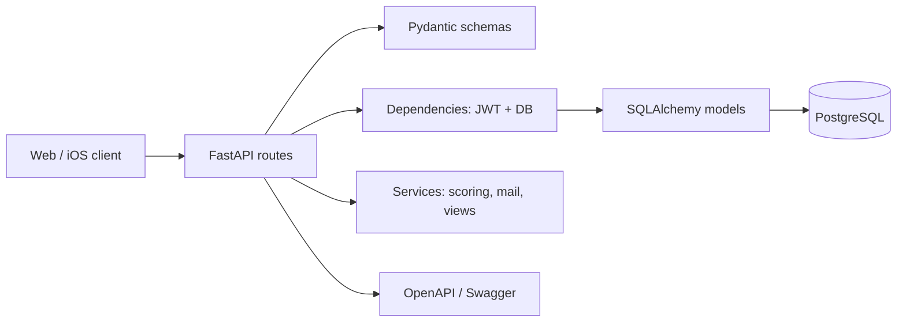

# Черновики материалов для отчётов Matchmaker

> Здесь есть готовые технические формулировки и шаблоны. В квадратных скобках нужно поставить реальные факты команды. Не подставляй вымышленные даты встреч, присутствующих или результаты коллег. В Moodle в части заданий Sprint 3/4 указан 2025 год, хотя проект и предыдущие задания относятся к 2026 году; срок надо сверить с преподавателем.

## 1. Короткий статус направления Backend & DevOps

**Исполнитель:** Егор Барташевич, Team Lead, Lead Backend & DevOps.

**Результат на текущей ветке:** реализован FastAPI backend Matchmaker с REST API, PostgreSQL-схемой и Alembic-миграцией, JWT-аутентификацией, email verification, профилями, проектами, рекомендациями на косинусном сходстве, свайпами и matches. Добавлены Swagger/OpenAPI, pytest, Ruff, request logging, Dockerfile, docker-compose, GitHub Actions, README и инструкция локального запуска.

**Проверено локально:** SQLite-тесты (`19 passed, 2 skipped`), PostgreSQL-тесты (`21 passed`), Ruff. Эндпоинты `/`, `/ping`, `/health`, `/docs` отвечают локально. Docker Compose не запускался на текущем компьютере, потому что Docker Desktop не установлен. Это нужно указать честно, а не писать «контейнеры проверены».

**Остаётся у команды:** React web-client и Node.js чат у Ромы, реальные HTTP-вызовы в KMP iOS у Алины, UI/UX и комплект проектной документации у Вероники. Для VPS нужны сервер, домен, SMTP и фактическая проверка на стенде.

## 2. Отчёт 2/3 — «Проектирование схемы базы данных»

### Текст для отчёта

Для Matchmaker спроектирована реляционная БД PostgreSQL. За основу взята начальная связь `USERS → PROFILES → PROFILE_SKILLS ← SKILLS`, после чего модель расширена сущностями `roles`, `projects`, `project_skills`, `project_roles`, `swipes`, `matches`, `project_members`, `email_codes` и `refresh_sessions`.

Пользователь и профиль связаны один-к-одному через уникальный `profiles.user_id`. Навыки связаны с профилями и проектами отношением многие-ко-многим. В промежуточной таблице `profile_skills` хранится уровень навыка от 1 до 5, в `project_skills` — важность навыка от 1 до 5. Уникальные и внешние ключи исключают дублирование и ссылки на несуществующие сущности. Пара `project_id + candidate_id` уникальна в таблице `matches`, поэтому один взаимный выбор не создаёт несколько совпадений.

Схема описана SQLAlchemy 2.0 моделями в `core-api/app/models.py`. Для воспроизводимого создания БД подготовлена миграция Alembic `0e5a5b1319e6_initial_matchmaker_schema.py`. Полная ER-диаграмма, словарь таблиц, правила удаления и индексы содержатся в `core-api/docs/database.md`.

### Что приложить

- скриншот Mermaid ER-диаграммы из `docs/database.md`;
- скрин Swagger или PostgreSQL/DBeaver с созданными таблицами;
- ссылку на миграцию;
- вывод `python -m alembic upgrade head` и `python -m alembic check`.

### Как показать преподавателю

1. Открой `database.md` и объясни одну цепочку: `users` → `profiles` → `profile_skills` → `skills`.
2. Покажи, почему навыки не хранятся строкой: можно строить фильтры и рекомендации.
3. Объясни, что match представляет пару «кандидат — проект», а не пару двух пользователей.
4. Покажи Alembic migration и команду применения.

## 3. Отчёт 2/4 — «Проектирование API. Создание README.md и gitignore»

### Текст для отчёта

Для backend выбран REST API с JSON и версионированием `/api/v1`. FastAPI автоматически формирует OpenAPI-спецификацию; интерактивная документация доступна по `/docs`, машинно-читаемое описание — по `/openapi.json`.

API включает системные методы (`/ping`, `/health`), регистрацию и вход, подтверждение email, восстановление пароля, управление профилем и навыками, каталог ролей и навыков, создание и модерацию проектов, рекомендации, свайпы и matches. Входные данные и ответы описаны Pydantic-моделями, поэтому API отклоняет некорректный JSON со статусом `422` до выполнения бизнес-логики.

README содержит шаги запуска на Windows, работу с PostgreSQL, Docker Compose, переменные окружения, миграции, тесты, Swagger, email outbox и назначение администратора. `.gitignore` исключает `.venv`, `.env`, `.local`, базы данных, кэши и IDE-настройки. В репозитории есть только `.env.example`, не содержащий секретов.

### Что приложить

- скрин `/docs` с группами Auth, Profiles, Projects, Recommendations, Matches;
- скрин успешного `/health`;
- ссылку на `README.md`, `core-api/README.md`, `docs/api.md`, `.gitignore`;
- пример одного запроса и ответа из Swagger.

## 4. Отчёт 3/4 — «Архитектура на backend»

### Текст для отчёта

В backend применена послойная архитектура. HTTP-слой находится в `app/api`: он принимает запросы, получает текущего пользователя и возвращает ответы. Pydantic-схемы в `schemas.py` выполняют валидацию границы API. SQLAlchemy-модели в `models.py` описывают доменные таблицы и связи. В `services/` вынесены алгоритм cosine scoring, отправка email-кодов и преобразование ORM-объектов в API-представления. `core/` содержит конфигурацию, безопасность JWT/Argon2 и ограничения частоты запросов. `db.py` управляет SQLAlchemy engine и жизненным циклом сессии.

На примере `User` цепочка выглядит так: маршрут `/api/v1/auth/register` получает Pydantic `Register`, нормализует email и проверяет пароль; создаёт ORM `User` и `Profile`; сохраняет их транзакцией; создаёт хешированный email-code; отправляет сообщение через отдельный mail-service. В HTTP-ответ не попадают пароль и его хеш. Такой подход отделяет web-интерфейс от хранения данных и бизнес-операций, упрощает тестирование и замену отдельных инфраструктурных компонентов.

### Схема для отчёта



## 5. Отчёт 4/1 — «Модульное тестирование и журналирование на Backend»

### Текст для отчёта

Для проверки backend используются `pytest` и FastAPI `TestClient`. Тесты изолируют данные в отдельной временной БД. Набор тестов покрывает регистрацию, повторный email, email verification, ограничение попыток, вход, refresh-token rotation, logout, reset password, права администратора, профиль, навыки, рекомендации, модерацию проектов, доступ к match и параллельные реакции. Отдельный запуск выполняется на PostgreSQL, так как там проверяются транзакционные свойства и блокировки.

Статический анализ выполняется Ruff: `ruff check .` и `ruff format --check .`. В `main.py` настроен Loguru: фиксируются request ID, метод, путь, статус и длительность запроса. Пароли, JWT и тело запроса в журнал не попадают. Ошибки `500` возвращаются клиенту нейтрально с request ID.

### Что приложить

```text
python -m pytest -q
python -m scripts.test_postgres
python -m ruff check .
python -m ruff format --check .
```

Вставь реальные выводы последних запусков, а не цифры из старой консоли.

## 6. Отчёт 4/2 — «JWT-авторизация»

### Текст для отчёта

Пароль хранится только как Argon2-хеш. После подтверждения email API выдаёт короткоживущий access JWT и refresh JWT. Access token передаётся в заголовке `Authorization: Bearer <token>`; зависимость FastAPI проверяет подпись, срок действия, тип токена, пользователя и его `token_version`.

Refresh token связан с записью в `refresh_sessions`. При обновлении токенов старая сессия атомарно помечается отозванной и создаётся новая. Поэтому один refresh token нельзя применить дважды. Logout увеличивает `token_version` и удаляет refresh sessions, после чего ранее выданные access token перестают проходить проверку. Email-коды хранятся в виде HMAC digest, одноразовые и ограничены по времени и числу попыток.

## 7. Отчёт 4/3 — «Swagger»

### Текст для отчёта

Swagger UI доступен по `/docs`; FastAPI генерирует его из маршрутов и Pydantic-моделей. Для работы без внешних CDN CSS и JavaScript Swagger добавлены в образ/окружение как локальные assets. Через Swagger можно открыть каждую операцию, посмотреть требуемый JSON, выполнить запрос и увидеть фактический ответ. Для закрытых методов сначала выполняется login, затем access token вставляется в кнопку **Authorize**.

## 8. Отчёт 4/4 — «Сетевое взаимодействие»

### Текст для отчёта

Клиенты взаимодействуют с backend по HTTP/JSON. Для web development разрешены origins `http://localhost:5173` и `http://127.0.0.1:5173`; методы и заголовки заданы CORS middleware. Для мобильного клиента CORS не применяется, но требуется корректный доступ к адресу стенда. REST-контракт подробно описан в `docs/api.md` и доступен через `/openapi.json`.

Для локального окружения docker-compose определяет четыре сервиса: API, PostgreSQL, Redis и Mailpit. API ожидает PostgreSQL по внутреннему имени `db`, Redis по `redis`, почтовый SMTP — Mailpit. Промышленная интеграция с Node.js chat-service и внешний VPS ещё требуют кода чата, адреса сервера, TLS и реального теста end-to-end.

## 9. Бэклог Sprint 2: черновик для Team Lead

Заполняй только после согласования приоритетов всей командой.

| ID | Задача | Исполнитель | Критерий готовности |
|---|---|---|---|
| BE-01 | Проектирование ER-схемы | Егор | ERD, словарь таблиц, миграция применима |
| BE-02 | Контракт REST API | Егор | OpenAPI, `docs/api.md`, README, `.gitignore` |
| UX-01 | Use Case и сценарии | Вероника + команда | диаграмма и сценарии согласованы |
| UX-02 | UI Kit и прототип | Вероника | ссылка на Figma, состояния экранов |
| WEB-01 | Каркас React-клиента | Рома | проект запускается, есть экран auth |
| IOS-01 | KMP каркас и auth UI | Алина | приложение собирается, экраны переходят |
| CHAT-01 | Контракт чата | Рома + Егор | согласованы auth и `room_key` |

**Definition of Done:** код в репозитории, инструкции запуска, проверка, ссылка/скрин артефакта, нет секретов в Git, задача обсуждена командой.

## 10. Шаблон Scrum meeting

```markdown
# Scrum meeting [номер] — [дата]

Присутствовали: [перечислить только фактических участников].

## Что сделано с прошлого meeting
- Егор: [например: подготовлена Alembic-миграция и API-контракт].
- Рома: [реальный факт].
- Алина: [реальный факт].
- Вероника: [реальный факт].

## План до следующей встречи
- Егор: [конкретная проверяемая задача].
- Рома: [...].
- Алина: [...].
- Вероника: [...].

## Блокеры и решения
- [блокер или «нет»].
- Решение: [кто и до какой даты делает].

## Решения команды
- [например: API использует префикс /api/v1; match создаётся только при двух like].
```

## 11. Шаблон Sprint Review и Retrospective

```markdown
# Sprint [номер] Review — [дата]

Цель спринта: [цель].

Демонстрация:
- [фактическая ссылка на Figma / GitHub / API].
- [сценарий, который показали].

Выполнено: [задачи с доказательствами].
Не выполнено: [задачи и честная причина].

# Sprint [номер] Retrospective

Что получилось:
- [факт].

Что мешало:
- [факт].

Изменение на следующий спринт:
- [одно конкретное правило или действие с ответственным].
```

Не записывай «всё сделано», если например React или WebSocket ещё не написаны. Хорошая ретроспектива ценнее фиктивного положительного отчёта: она показывает, что команда умеет замечать риск и менять план.
